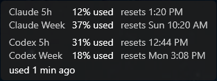
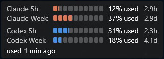
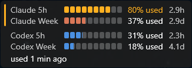

# Bingo

A small always-on-top readout for Windows showing how much of your Claude subscription usage
window is left, and when it resets.

Claude Code on a Max or Pro plan is governed by rolling usage windows rather than per-token cost.
The thing that actually interrupts you is running out of window mid-task, and the only way to
check is to stop and run `/usage` in a session — which is the interruption you were trying to
avoid. Bingo keeps the answer in peripheral vision so it arrives before it matters.

**Status:** in daily use, and still versioned 0.x while the endpoint it reads stays undocumented.
Download the latest version from the [Releases page](https://github.com/stevensT/bingo-hud/releases);
[`CHANGELOG.md`](CHANGELOG.md) lists what each version adds.

## What it shows

A frameless, draggable, always-on-top window with the percentage used and the reset time for
both the 5-hour and weekly windows, one line each:



Two settings in the tray menu change how a line reads. A countdown shows the reset as time left
at every distance, and a bar of ten segments sits beside each figure, filled to it: Claude
orange within normal limits.



As a window runs low, its figure and bar turn amber at 25% left and red at 10%, and a stripe on
the left edge shows the worst of them:



Percentages read as consumed by default, matching `/usage`. You can switch them to show what
is left instead; either way the figure says which it is, so it can never be read backwards.

Clicking it opens a detail panel with per-model weekly caps, exact reset times, current status,
and the running version. Threshold alerts raise a desktop notification once per window.

## How it works

Bingo reads your quota from the same endpoint Claude Code's own `/usage` command uses,
authenticating with the OAuth token Claude Code already maintains on your machine. It does not
ask for an API key, and no plan limits are hardcoded anywhere in the codebase — the percentages
come from the server, not from a guess about your plan.

Two consequences worth stating plainly:

- **That endpoint is undocumented.** Its payload has changed shape more than once. Bingo parses
  it tolerantly and, when it can't recognize what came back, says so. It never estimates or fills
  in a number the server didn't send. The last reading it did receive stays on screen, marked
  with its age and with why it stopped updating, so it can't be mistaken for a current one. A
  readout you trust at a glance is worse than useless if it can quietly lie.
- **Nothing leaves your machine.** The only network call is to the quota endpoint. Your token is
  never logged, copied, or transmitted anywhere else, and there is no telemetry.

## Requirements

- Windows 10 or 11, 64-bit (tested on Windows 11)
- An active Claude Max or Pro subscription
- Claude Code installed and signed in — Bingo reads its credentials and delegates token refresh
  to it

## Removing Bingo

If you installed it with the setup program, uninstall it from **Settings > Apps > Installed
apps**. That closes Bingo if it is running and removes the app, its Start menu entry, and the
sign-in shortcut. Your settings stay in `%LOCALAPPDATA%\Bingo`, so reinstalling puts the HUD back
where you left it. To remove them as well, delete that folder after uninstalling. In PowerShell:

```
Remove-Item "$env:LOCALAPPDATA\Bingo" -Recurse
```

If you run the standalone exe instead, quit Bingo from its tray icon, then delete the exe, that
same folder, and any shortcut to it you put in your Startup folder (Win+R, `shell:startup`).

## Repository layout

| Path | Contents |
|---|---|
| `src/` | Application source — `BingoHud.Core` and `BingoHud.App`, described under Architecture |
| `tests/` | The test project, and the recorded endpoint responses it runs against |
| `tests/fixtures/usage/` | Dated, scrubbed captures of the quota endpoint, with their own README |
| `scripts/` | The endpoint capture script and the icon generator, run by hand rather than by the app |
| `installer/` | The setup script, and the check script that verifies an install, upgrade, or uninstall on this machine |
| `packaging/winget/` | The winget manifests, one folder per version, copied into `microsoft/winget-pkgs` to submit |
| `specs/` | Feature specifications, technical plans, and task lists |
| `specs/memory/constitution.md` | Architectural principles applied across the project |
| `docs/research/` | Background research, including a teardown of three prior-art usage monitors |

## Architecture

Two projects with one rule between them: `BingoHud.Core` decides, `BingoHud.App` draws.

- **`BingoHud.Core`** — polling, response parsing, threshold state, reset countdowns. No UI
  dependency, so the logic most likely to harbor bugs is the part under test.
- **`BingoHud.App`** — WPF shell. HUD window, detail panel, tray, notifications. Renders what
  Core says and holds no logic of its own.

If UI code starts making decisions, that decision belongs in Core. The poll policy and severity
evaluation are pure functions, and time is injected throughout Core, so cadence and staleness are
deterministic under test.

## Building

Requires the .NET 9 SDK. Verified 2026-08-30 against SDK 9.0.317 on Windows 11.

```
dotnet build
dotnet test
```

`dotnet build` produces a Debug build. Debug builds read two environment variables that point
Bingo at another credential file and another endpoint, for testing; Release builds ignore them.

The setup program is built with Inno Setup 6. Verified 2026-10-08 against Inno Setup 6.7.3,
installed per-user with:

```
winget install --id JRSoftware.InnoSetup --exact --scope user
```

That puts the command-line compiler at `%LOCALAPPDATA%\Programs\Inno Setup 6\ISCC.exe` and does
not add it to `PATH`, so call it by its full path. In PowerShell:

```
& "$env:LOCALAPPDATA\Programs\Inno Setup 6\ISCC.exe" /?
```

### Publishing

Bingo ships in two shapes, each a single `.exe`. Publish to separate folders under `artifacts/`,
which is git-ignored; the default publish folder is shared, so one would overwrite the other.

**Self-contained**, for the GitHub releases page and the setup program, which wraps it. Needs
nothing else installed, on any 64-bit Windows version .NET 9 supports. Tested on Windows 11 only:

```
dotnet publish src/BingoHud.App/BingoHud.App.csproj -c Release -r win-x64 --self-contained -p:PublishSingleFile=true -p:IncludeNativeLibrariesForSelfExtract=true -p:EnableCompressionInSingleFile=true -o artifacts/self-contained
```

**Framework-dependent**, for anyone who already has the .NET 9 Desktop Runtime. Same app, a
fraction of the download, but it will not start without that runtime:

```
dotnet publish src/BingoHud.App/BingoHud.App.csproj -c Release -r win-x64 --self-contained false -p:PublishSingleFile=true -o artifacts/framework-dependent
```

Each folder's `BingoHud.App.exe` is shipped renamed, as Releasing below describes. The `.pdb`
files beside each exe are debug symbols and are not shipped.

Measured 2026-09-22 on SDK 9.0.317, launched from a folder outside the repository:

| Shape | Executable | First launch | Later launches |
|---|---|---|---|
| Framework-dependent | 0.36 MB | 0.75 s | 0.56 s |
| Self-contained, compressed | 70.9 MB | 3.3 s | 0.73 s |
| Self-contained, uncompressed | 162 MB | 4.9 s | 0.58 s |

Compression is used for the self-contained build because it halves the download and its first
launch is faster, not slower: a single-file build unpacks its native libraries to disk on first
run, and a compressed one has less to unpack. Later launches cost about 0.15 s more. The
uncompressed size grew from about 120 MB when the tray icon arrived, because the notification-area
control comes from Windows Forms. Trimming is not available — WPF does not support it.

## Versioning

Semantic versioning. Bingo stays on `0.x` until it has proven itself in daily use; because it
depends on an undocumented endpoint, anything below `1.0.0` should be treated as liable to break
when that endpoint changes.

- **PATCH** — bug fixes, no behavior change a user would notice.
- **MINOR** — new behavior, new settings, or any change to how the upstream response is parsed.
  Endpoint-handling changes are always at least MINOR, because that is the axis along which this
  app breaks.
- **MAJOR** — reserved for 1.0.0 and beyond.

Three things move together on every release, and a release is not done until all three agree:

1. `<Version>` in `BingoHud.App.csproj` — what the running app reports in its detail panel.
2. A dated section in `CHANGELOG.md`, moved down out of `[Unreleased]`.
3. A git tag `vX.Y.Z` on the release commit.

The version earns its keep beyond bookkeeping: when the upstream payload drifts, the first
question is which build is misreading it. A version the app displays and a changelog that
explains it is what makes that answerable. Record user-visible changes under `[Unreleased]` as
they land.

## Releasing

Every release follows these steps, in order. Commands are PowerShell, run from the repository
root; `X.Y.Z` is the new version.

One rule overrides convenience: **a file attached to a published release is never replaced.** The
winget manifest pins the setup's SHA-256, so a replaced file fails the hash check on every winget
install. If a published file turns out to be wrong, release a new version instead.

1. **Choose the version** by the rules under Versioning.
2. **Bump and record.** Set `<Version>` in `src/BingoHud.App/BingoHud.App.csproj` to `X.Y.Z`,
   and move the entries under `[Unreleased]` in `CHANGELOG.md` into a new
   `## [X.Y.Z] - YYYY-MM-DD` section.
3. **Check the build.** Run `dotnet clean`, then `dotnet build` and `dotnet test`: no warnings, no
   failures. The clean matters, because an incremental build does not repeat warnings for
   projects it did not rebuild.
4. **Commit and tag.** Commit the release, then tag that commit and push both:

   ```
   git tag vX.Y.Z
   git push origin main vX.Y.Z
   ```

5. **Publish both executables** with the two commands under Publishing, from the tagged commit
   with no uncommitted changes. Check the version both carry; each reads `X.Y.Z+` followed by the
   tagged commit. A folder left over from an earlier release still holds that release's exe, so
   both are checked:

   ```
   (Get-Item artifacts\self-contained\BingoHud.App.exe).VersionInfo.ProductVersion
   (Get-Item artifacts\framework-dependent\BingoHud.App.exe).VersionInfo.ProductVersion
   ```

6. **Build the setup program** from the self-contained build:

   ```
   & "$env:LOCALAPPDATA\Programs\Inno Setup 6\ISCC.exe" /DAppVersion=X.Y.Z /DSourceExe=artifacts\self-contained\BingoHud.App.exe /DOutputDir=artifacts\release-X.Y.Z installer\bingo.iss
   ```

7. **Gather the release files** beside the setup, renamed so they can sit side by side on one
   release:

   ```
   Copy-Item artifacts\self-contained\BingoHud.App.exe artifacts\release-X.Y.Z\Bingo-X.Y.Z-win-x64.exe
   Copy-Item artifacts\framework-dependent\BingoHud.App.exe artifacts\release-X.Y.Z\Bingo-X.Y.Z-win-x64-framework-dependent.exe
   ```

8. **Scan the release files with Microsoft Defender.** The scan must report no threats and the
   exit code must be 0; 2 means a threat was found, and anything else means the scan did not
   run. If it finds one, stop and report it to Microsoft as a false positive before uploading
   anything:

   ```
   & "$env:ProgramFiles\Windows Defender\MpCmdRun.exe" -Scan -ScanType 3 -File "$PWD\artifacts\release-X.Y.Z" -DisableRemediation
   $LASTEXITCODE
   ```

9. **Test the upgrade** over the previous version, installed and running, with the setup fully
   silent, as `winget install --silent` runs it. A plain winget install uses `/SILENT` instead,
   which shows a progress window; both skip the Launch box. The exit code must be 0. Then run the
   check script; add `-StartsAtSignIn` if the installed copy starts at sign-in. Every check must
   pass, and Bingo must be running again with the HUD where it was:

   ```
   $setup = Start-Process artifacts\release-X.Y.Z\Bingo-X.Y.Z-setup.exe -ArgumentList '/VERYSILENT /SUPPRESSMSGBOXES /NORESTART /SP-' -PassThru
   $setup.WaitForExit()
   $setup.ExitCode
   installer\check-install.ps1 -Expect Installed -Version X.Y.Z
   ```

   Do not use `Start-Process -Wait` here. In Windows PowerShell it waits for every process the
   setup starts, and the setup restarts Bingo as its last step, so the wait never ends.
10. **Hash the release files.** These go in the release notes. The list must name all three
    files; a missing one is simply left out, with no error:

    ```
    Get-FileHash artifacts\release-X.Y.Z\*.exe
    ```

11. **Publish the GitHub release** from the `vX.Y.Z` tag, with the three files from
    `artifacts\release-X.Y.Z` attached and the notes listing what changed and each file's SHA-256.
12. **Hash the uploaded setup.** Download it from the release and compare it with the local
    file; the last line must print `True`. The hash printed above it is the one the manifest
    uses. If they differ, stop: do not replace the file.

    ```
    $ProgressPreference = 'SilentlyContinue'
    Invoke-WebRequest https://github.com/stevensT/bingo-hud/releases/download/vX.Y.Z/Bingo-X.Y.Z-setup.exe -OutFile artifacts\uploaded-X.Y.Z-setup.exe
    $uploaded = (Get-FileHash artifacts\uploaded-X.Y.Z-setup.exe).Hash
    $uploaded
    $uploaded -eq (Get-FileHash artifacts\release-X.Y.Z\Bingo-X.Y.Z-setup.exe).Hash
    ```

13. **Write the manifest.** Copy the previous version's folder under `packaging\winget\stevensT.Bingo\`
    to a new `X.Y.Z` folder, then edit the copies in an editor:
    - all three files: `PackageVersion`;
    - `stevensT.Bingo.installer.yaml`: `ReleaseDate` (the day the release was published),
      `InstallerUrl`, and `InstallerSha256` from step 12;
    - `stevensT.Bingo.locale.en-US.yaml`: `ReleaseNotesUrl`.

    Nothing else changes unless the setup itself changed.
14. **Check the manifest.** winget's own validation must pass:

    ```
    winget validate --manifest packaging\winget\stevensT.Bingo\X.Y.Z
    ```

    Then, with Bingo running, install it through the manifest. winget downloads the setup, checks
    its hash, and runs it the way it will on other machines. That is not the same as running it
    directly: started by winget, the setup has been seen to get no help from Windows in closing
    Bingo, which step 9 cannot show. winget must report "Successfully installed", Bingo must be
    running again, and every check must pass (with `-StartsAtSignIn` if it starts at sign-in).
    This needs local manifests turned on, an administrator setting: run
    `winget settings --enable LocalManifestFiles` in an administrator terminal first, and
    `winget settings --disable LocalManifestFiles` after.

    ```
    winget install --manifest packaging\winget\stevensT.Bingo\X.Y.Z
    installer\check-install.ps1 -Expect Installed -Version X.Y.Z
    ```

15. **Commit the manifest folder** and push it.
16. **Submit to winget.** In a fork of
    [`microsoft/winget-pkgs`](https://github.com/microsoft/winget-pkgs), copy the folder to
    `manifests/s/stevensT/Bingo/X.Y.Z/` and open a pull request. Its automated checks install the
    package on a clean machine; a moderator then reviews and merges it.

## Prior art

Three shipping usage monitors informed this design, and
[`docs/research/usage-monitor-teardown.md`](docs/research/usage-monitor-teardown.md) records what
was learned from reading them: the endpoint contract, the error taxonomy, the credential handling,
and the display conventions all three converged on independently.

## License

MIT — see [LICENSE](LICENSE).
